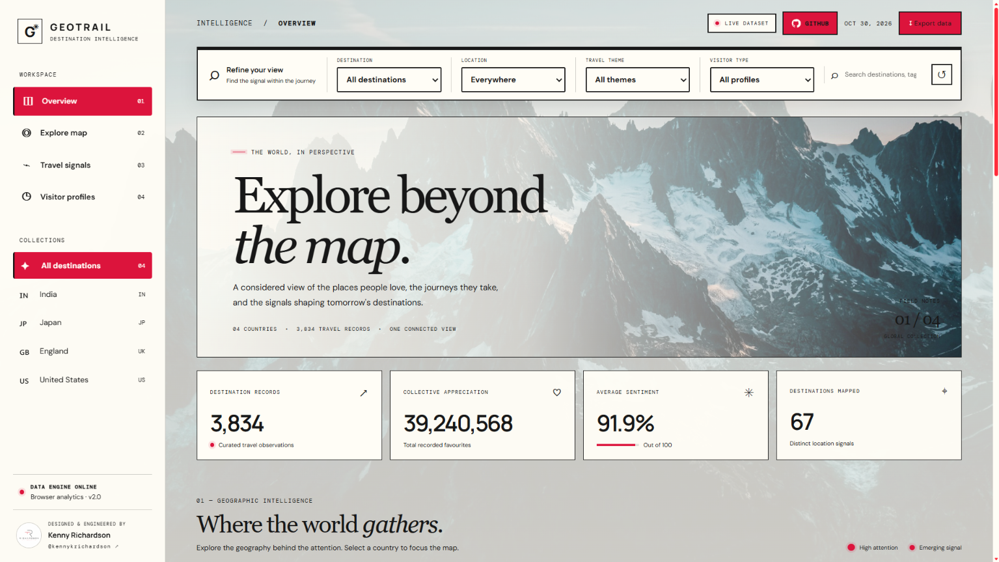
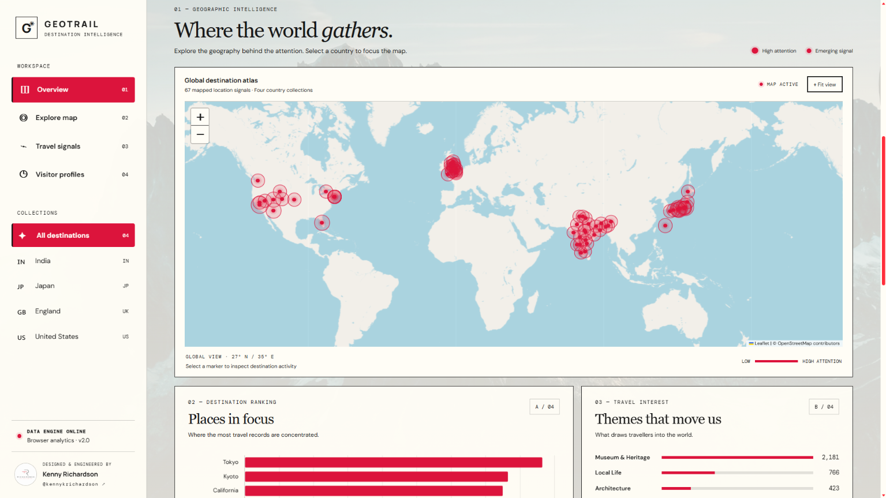
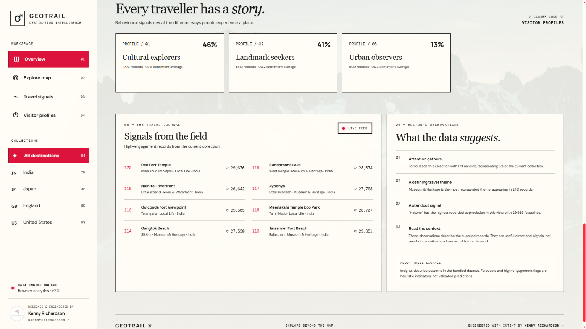
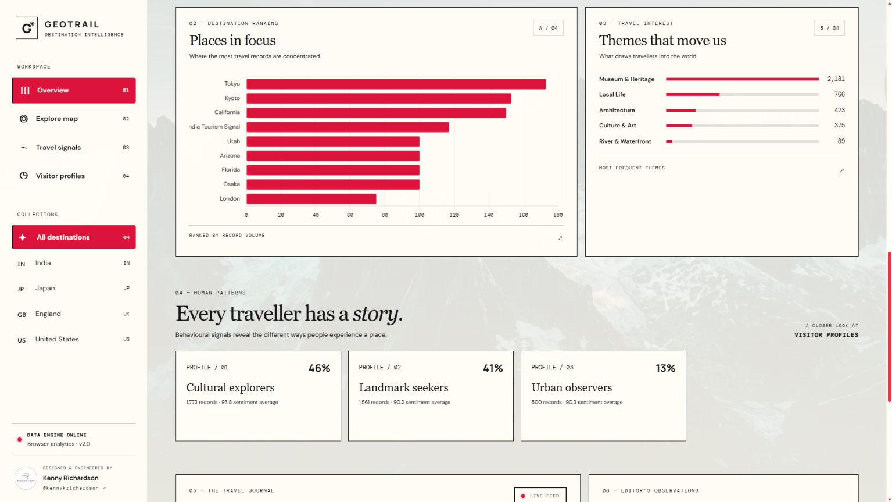

# 🌍 GeoTrail

### ✨ Every traveller has a story.

GeoTrail is a tourism intelligence dashboard that turns destination and traveller data into an interactive, visual exploration experience. It brings destination signals, visitor patterns, travel interests, and editorial observations together in one responsive interface.

## 🚀 Features

- 🗺️ **Interactive destination map** to explore tourism locations.
- 📊 **Tourism overview metrics** for a quick snapshot of the available records.
- 🧳 **Traveller profiles** that surface patterns in visitor behaviour.
- 🔴 **Live location feed** that presents incoming destination signals in a continuously updating stream.
- 📈 **Destination and travel-interest charts** for comparing locations and themes.
- 💡 **Editorial observations** that add context to the displayed data.
- 📥 **JSON export** for taking the underlying records elsewhere.
- 📱 **Progressive Web App support** for an installable experience and offline-friendly asset caching.

## 🧰 Tech stack

| Technology | Purpose |
|---|---|
| HTML, CSS, JavaScript | Core frontend |
| [Vite](https://vite.dev/) | Development server and production builds |
| [Leaflet](https://leafletjs.com/) | Interactive maps |
| [Chart.js](https://www.chartjs.org/) | Data visualisations |

## ⚡ Getting started

### 📋 Requirements

- Node.js (a current LTS release is recommended)
- npm

### 1. 📦 Install dependencies

```bash
npm install
```

### 2. 💻 Start the development server

```bash
npm run dev
```

Vite will print the local development URL in the terminal.

### 3. 🏗️ Create a production build

```bash
npm run build
```

### 4. 🔍 Preview the production build

```bash
npm run preview
```
---

# 📸 Screenshots

## 🖥️ Dashboard Overview



---

## 🗺️ Tourism Heatmap



---

## 📡 Live Data Feed



---

## 📈 Dynamic Analytics Graph



---

## 📁 Project structure

A typical project layout looks like this:

```text
.
├── public/
│   ├── data/
│   │   └── tourism-records.json
│   └── assets/
│       └── geotrail-bg.jpg
├── index.html
├── app.js
├── styles.css
├── package.json
└── README.md
```

Your local project may contain additional configuration, icons, service-worker files, or source directories. Keep those files in place when building or deploying.

## 🧭 Tourism data

The dashboard reads its tourism records from:

```text
public/data/tourism-records.json
```

Keep the JSON structure consistent with the fields expected by the application. When adding or editing records:

1. ✅ Use valid JSON.
2. 🧩 Preserve the field names and data types already used by the dataset.
3. 📍 Check that destination names and geographic coordinates are valid.
4. 🧪 Rebuild and test the dashboard after changing the data.

The current dataset has included destinations from India, Japan, England, and the United States. The actual destinations shown depend on the records present in the data file.

## ☁️ Deployment

GeoTrail can be deployed to any static hosting provider that supports a Vite production build.

1. 📦 Install dependencies.
2. 🏗️ Run `npm run build`.
3. 🚀 Deploy the generated `dist/` directory.
4. ⚙️ Configure the hosting provider to serve `index.html` for application routes if your deployment setup requires it.

Set the deployment base path in Vite if the app is hosted under a subdirectory rather than at the domain root.

## 🌐 Browser support

Use a modern browser with JavaScript enabled. Map tiles and any externally hosted map resources require an internet connection. Offline behaviour depends on the service worker and the assets successfully cached by the application.

## 👨‍💻 Credits

Designed and engineered with intent by **Kenny Richardson**.

- 🐙 GitHub: [kennykrichardson](https://github.com/kennykrichardson)
- 💼 LinkedIn: [Kenny Richardson](https://linkedin.com/in/kennykrichardson)

## 📄 License

This project is licensed under the MIT License. See [LICENSE](LICENSE) for details.

---

<p align="center">
  🌍 <strong>GeoTrail</strong> · Every traveller has a story.
</p>
